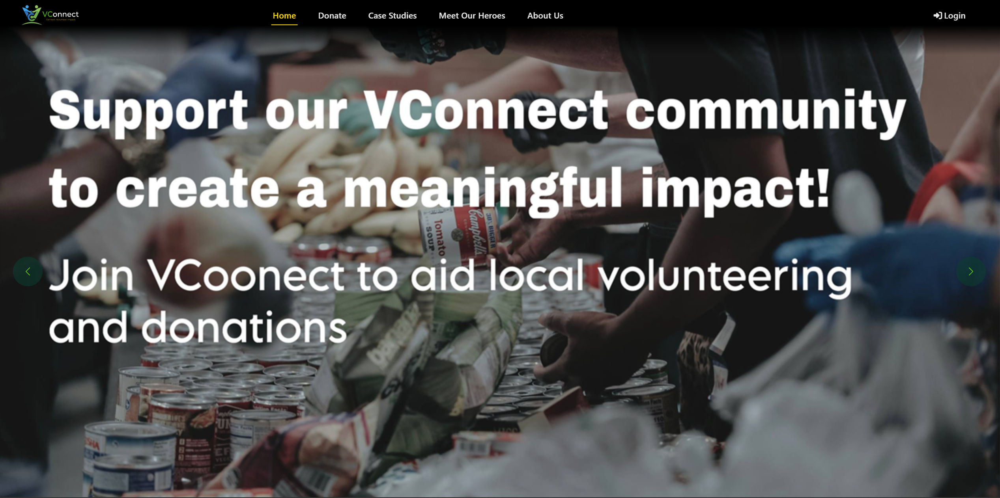
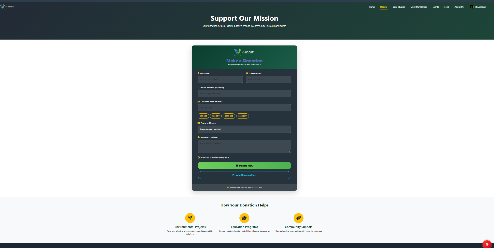
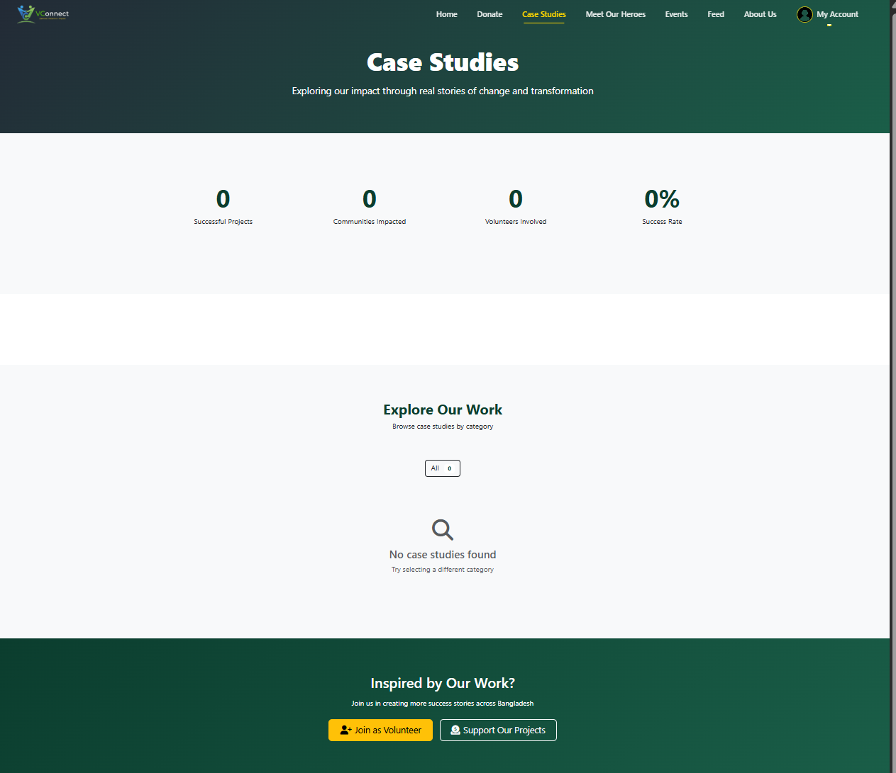
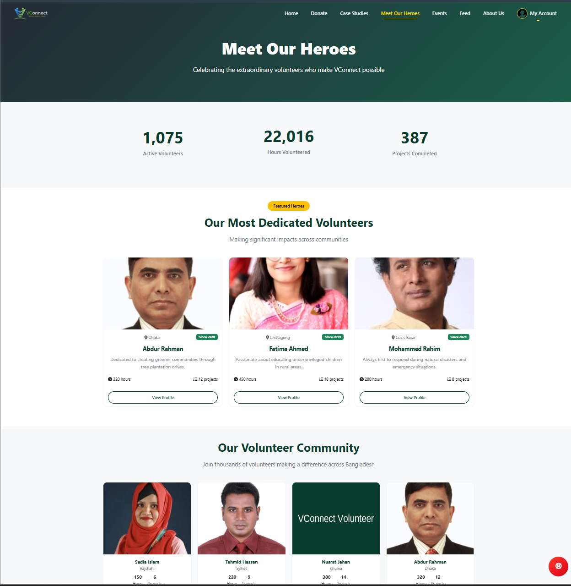
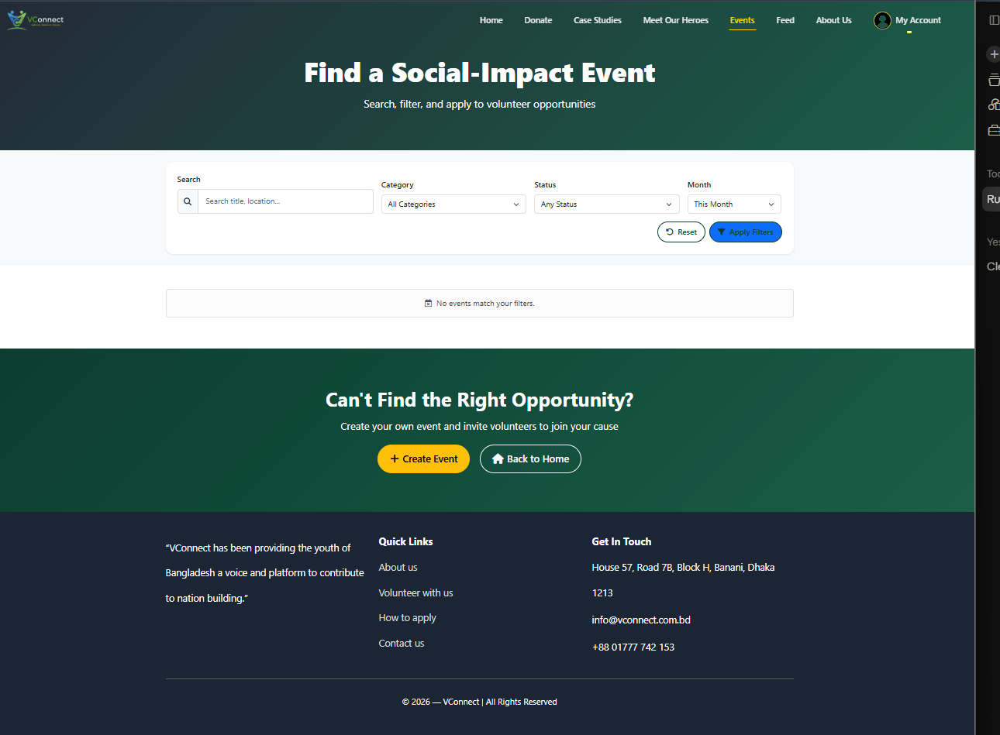
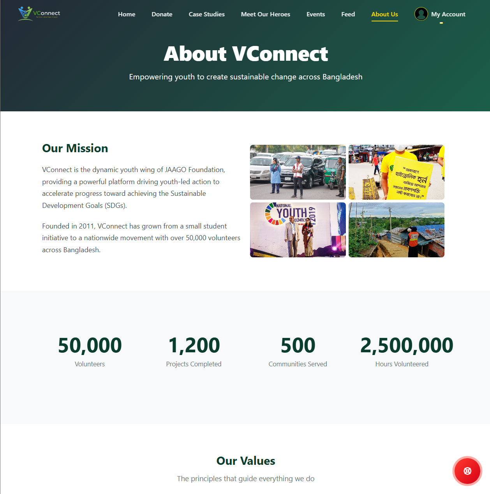
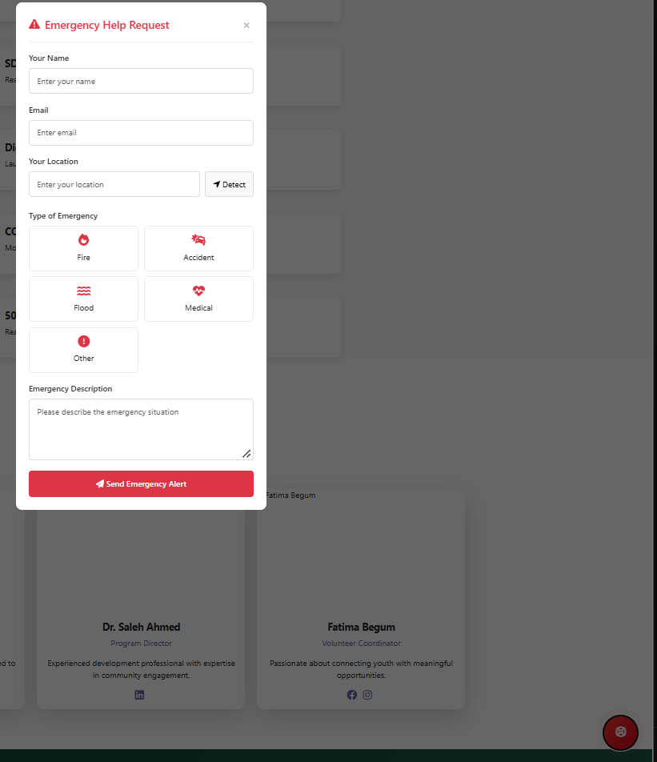
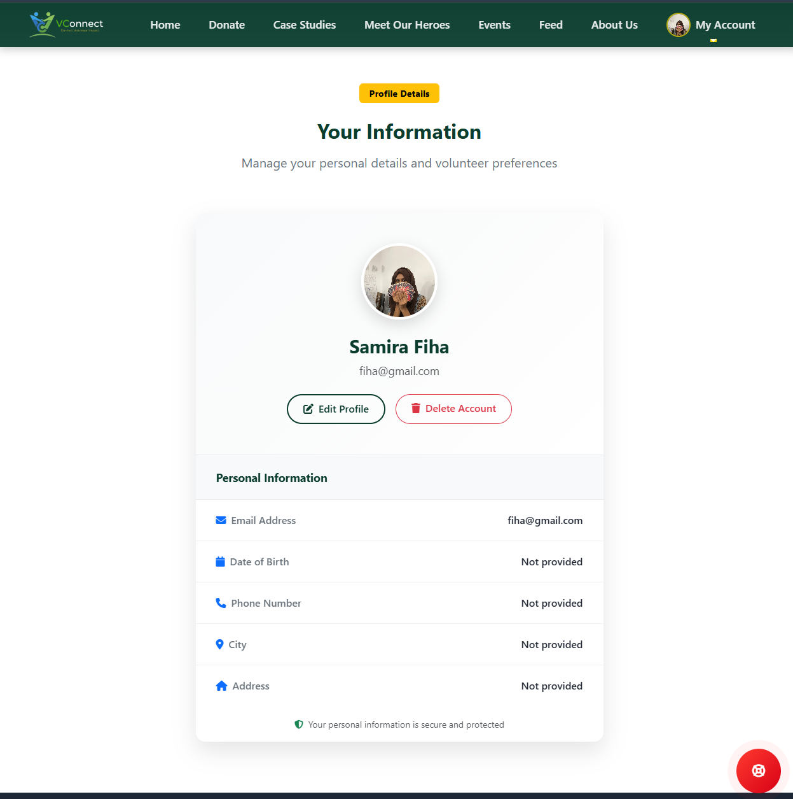

# VConnect

**Connect. Volunteer. Impact.**

VConnect is an ASP.NET Core MVC web platform that connects volunteers, donors, and communities in Bangladesh. People can donate, find and apply to volunteer events, follow case studies, meet volunteer heroes, and post emergency (SOS) requests that the community can respond to. Administrators manage everything from a dedicated admin area.

---

## Table of Contents

- [Features](#features)
- [Screenshots](#screenshots)
- [Tech Stack](#tech-stack)
- [Prerequisites](#prerequisites)
- [Getting Started](#getting-started)
- [Creating an Admin Account](#creating-an-admin-account)
- [Admin Area](#admin-area)
- [Database](#database)
- [Project Structure](#project-structure)
- [Troubleshooting](#troubleshooting)
- [Team Members](#Team-Members)
- 

---

## Features

### Public site

| Page | Description |
|------|-------------|
| **Home** | Hero banner and a carousel of the latest activities |
| **Donate** | Donation form (name, email, amount in BDT, payment method, message, anonymous option) and donation stats |
| **Case Studies** | Browse real stories of impact by category, with galleries, milestones, and impact stats |
| **Meet Our Heroes** | Featured volunteers and the volunteer community, with hours and projects |
| **Events** | Search and filter volunteer events by category, status, and month; apply to events; create your own event |
| **Feed** | Community feed of SOS posts with comments and replies |
| **About Us** | Mission, values, timeline, and leadership team |
| **My Account** | Register, log in, and manage your profile details |

### SOS / Emergency requests

A floating red **SOS** button is available on every page. It opens an *Emergency Help Request* form with:

- Name, email, and location (with a **Detect** button for automatic location)
- Emergency type: Fire, Accident, Flood, Medical, or Other
- A description of the situation

Requests appear in the **Feed**, where other users can comment and reply.

> [!IMPORTANT]
> The SOS feature is a community help board. It is **not** a replacement for official emergency services. In a real emergency, call **999** in Bangladesh.

### Authentication and roles

- Cookie-based authentication with passwords hashed using **BCrypt**
- Two roles: `Volunteer` (default for new accounts) and `Admin`
- "Remember me" keeps you signed in for 30 days; otherwise the session lasts 1 day
- Admins are redirected to the admin dashboard after login

---

## Screenshots

Place your screenshots in a `screenshots/` folder in the project root using the file names below.

| | |
|---|---|
|  |  |
|  |  |
|  |  |
|  |  |  |

---

## Tech Stack

- **Framework:** ASP.NET Core MVC on .NET 9 (C#, Razor views)
- **ORM:** Entity Framework Core 9 with code-first migrations
- **Database:** PostgreSQL (via `Npgsql.EntityFrameworkCore.PostgreSQL`)
- **Authentication:** Cookie authentication
- **Password hashing:** BCrypt.Net-Next
- **Architecture:** Controllers, service layer (`IUserService`, `IEventService`, `IDonationService`, `IStudyService`, `ISosService`, `IProfileDetailsService`), and an `Admin` area

---

## Prerequisites

| Tool | Version | Download |
|------|---------|----------|
| .NET SDK | 9.0 | https://dotnet.microsoft.com/download |
| PostgreSQL | 17 (14 or newer works) | https://www.postgresql.org/download/ |
| Code editor | Visual Studio 2022, VS Code with C# Dev Kit, or Rider | |
| EF Core CLI tool | | `dotnet tool install --global dotnet-ef` |
| pgAdmin 4 (optional) | | https://www.pgadmin.org/download/ |

Check your .NET install:

```bash
dotnet --version
```

---

## Getting Started

### 1. Clone the repository

```bash
git clone https://github.com/SA-Fiha/VConnect.git
cd VConnect
```

### 2. Start PostgreSQL

If you installed PostgreSQL with the installer, it runs as a Windows service automatically. If you use the zip version, start it manually (and again after every reboot):

```bash
pg_ctl -D <path-to-data-folder> -l logfile start
```

### 3. Configure the connection string

Edit `appsettings.json` and set your PostgreSQL password:

```json
{
  "ConnectionStrings": {
    "VConnect": "Host=localhost;Port=5432;Database=VConnect;Username=postgres;Password=YOUR_PASSWORD"
  }
}
```

> [!WARNING]
> Never commit real passwords to a public repository. Keep your password in [User Secrets](https://learn.microsoft.com/aspnet/core/security/app-secrets) instead:
>
> ```bash
> dotnet user-secrets init
> dotnet user-secrets set "ConnectionStrings:VConnect" "Host=localhost;Port=5432;Database=VConnect;Username=postgres;Password=YOUR_PASSWORD"
> ```

### 4. Restore, create the database, and run

```bash
dotnet restore
dotnet ef database update
dotnet run
```

`dotnet ef database update` creates the `VConnect` database (if needed) and applies all migrations.

Open the URL printed in the terminal, for example `https://localhost:7xxx` or `http://localhost:5xxx`.

> [!TIP]
> If your browser warns about the HTTPS certificate, run `dotnet dev-certs https --trust` once.

---

## Creating an Admin Account

New accounts are created with the `Volunteer` role. To create your first admin:

1. Register normally on the website.
2. Update the role in the database (pgAdmin Query Tool or `psql`):

   ```sql
   UPDATE "Users" SET "Role" = 'Admin' WHERE "Email" = 'your@email.com';
   ```

3. **Log out and log in again.** The role is stored in the login cookie, so the change only applies after a new login.

The role name is case-sensitive and must be exactly `Admin`. After logging in, admins are redirected to `/Admin/Dashboard`.

Once you have one admin, more users can be created from `/Admin/Users/Create`.

---

## Admin Area

Access to the admin area is restricted by the `[AdminOnly]` attribute. Anyone who is not logged in as `Admin` is redirected to the home page.

| Route | Purpose |
|-------|---------|
| `/Admin/Dashboard` | Totals for donations, events, and volunteers; latest 5 events and donations |
| `/Admin/Donations` | View all received donations and donation details |
| `/Admin/DonationsProvided` | List, create, view, and delete donations provided to those in need |
| `/Admin/Events` | List and create events, and change event status |
| `/Admin/Posts` (also `/Admin/Emergencies`) | Moderate SOS posts: view details, delete posts and comments |
| `/Admin/Users` | List users and create new users |

---

## Database

The database has 16 tables created by the initial migration (`20250916070700_initialCreate`):

| Area | Tables |
|------|--------|
| Users | `Users`, `ProfileDetails` |
| Events | `Events`, `EventApplications`, `Participations`, `EventNotifications` |
| Donations | `Donations`, `DonationProvided` |
| Case studies | `Studies`, `Categories`, `CaseGalleryImages`, `Milestones`, `ImpactStats` |
| SOS | `SosPosts`, `SosComments` |
| EF Core | `__EFMigrationsHistory` |

> [!NOTE]
> EF Core creates table and column names with capital letters, so wrap them in double quotes in SQL: `SELECT * FROM "Users";`

### Adding a migration

After changing a model:

```bash
dotnet ef migrations add MigrationName
dotnet ef database update
```

---

## Project Structure

```
VConnect/
├── Areas/
│   └── Admin/
│       ├── Controllers/     # Dashboard, Donations, DonationsProvided, Events, Posts, Users
│       ├── Models/          # AdminDashboardViewModel, AdminEventViewModel
│       └── Views/
├── Controllers/             # About, Account, Case, Donation, Events, Feed, Heroes, Home, ProfileDetails, Sos
├── Database/
│   └── ApplicationDbContext.cs
├── Filters/
│   └── AdminOnlyAttribute.cs
├── Migrations/
├── Models/
│   ├── Cases/               # Study, Category, CaseGalleryImage, Milestone, Impact_Stats
│   ├── Enums/               # ApplicationStatus, EventStatus
│   ├── Events/              # Event, EventApplication, EventNotification, Participation
│   ├── SOS/                 # SosPost, SosComment, SosEnums
│   └── ...                  # ApplicationUser, Donation, ProfileDetails, view models
├── Services/                # Business logic (user, event, donation, study, SOS, profile)
├── Views/
├── wwwroot/                 # Static files (CSS, JS, images)
├── Program.cs
└── appsettings.json
```

---

## Troubleshooting

| Problem | Fix |
|---------|-----|
| `Failed to connect to 127.0.0.1:5432` | PostgreSQL is not running. Start the service or run `pg_ctl ... start`. |
| `password authentication failed` | The password in your connection string does not match the `postgres` user's password. |
| `You must install .NET to run this application` | Install the .NET 9 SDK, or make sure the project's `TargetFramework` matches your installed SDK. |
| `relation "users" does not exist` | Table names are case-sensitive. Use `"Users"` with double quotes. |
| Admin changes not applied | Log out and log in again after changing a role. |
| `dotnet-ef` version warning | Match the tool to EF Core: `dotnet tool update --global dotnet-ef --version 9.0.9`. |

## Team Members

| ID          | Name                   | Email                              | Role              |
|-------------|------------------------|------------------------------------|-------------------|
| 20200204058 | Mahdi Mubassera        | mubasseramahdi@gmail.com | Frontend |
| 20220104064 | Abdul Mohaimen Khan Arnob | abdulmohaimenkhanarnob@gmail.com |  Frontend |
| 20220104068 | Samira Ahmed Fiha  | fihaahmed@outlook.com | Lead + Frontend + Backend       |
